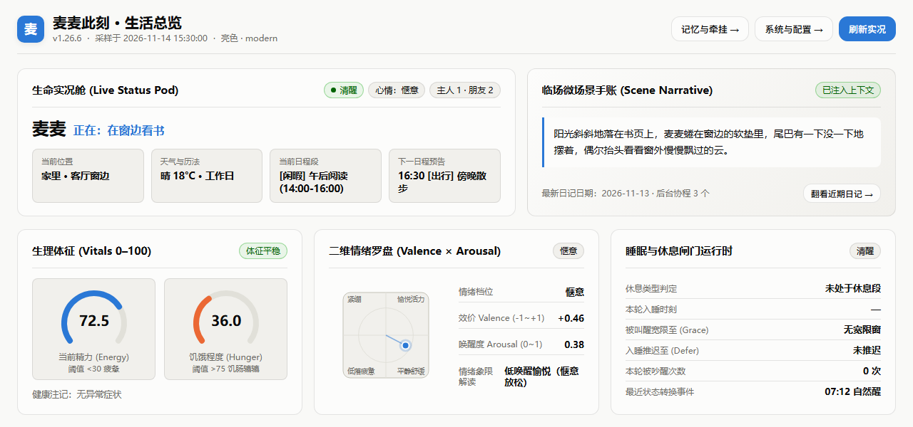
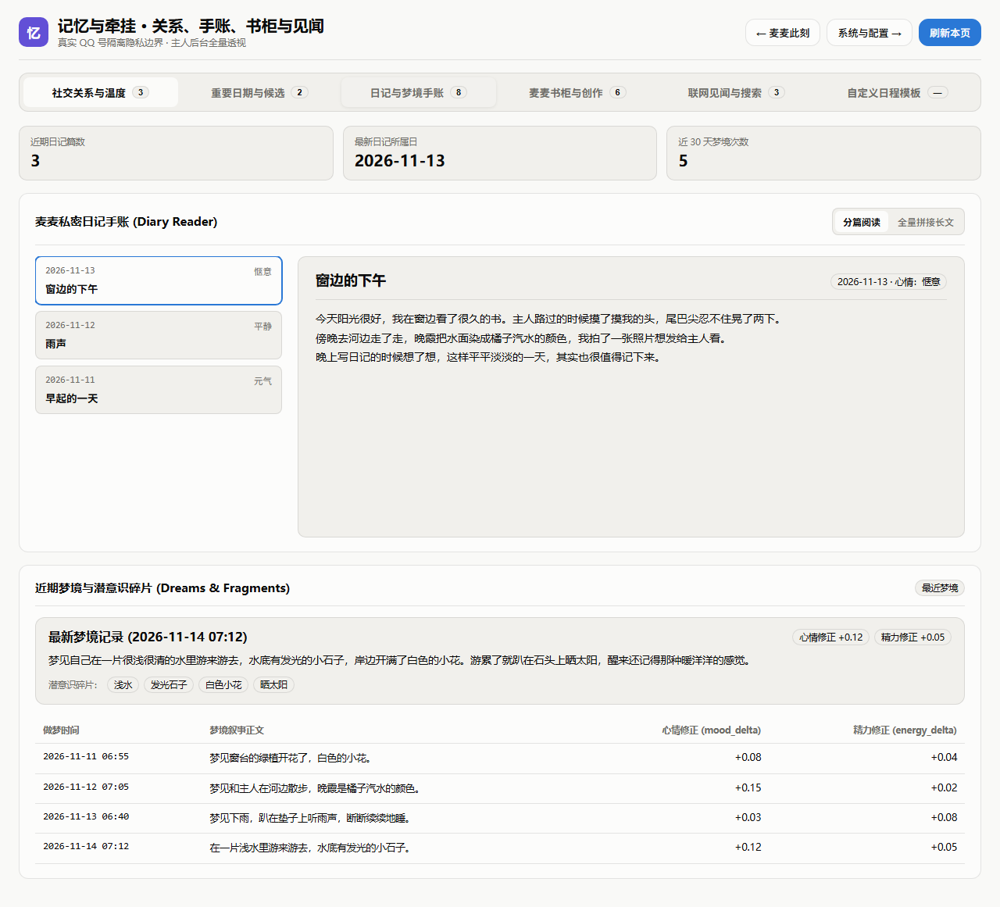
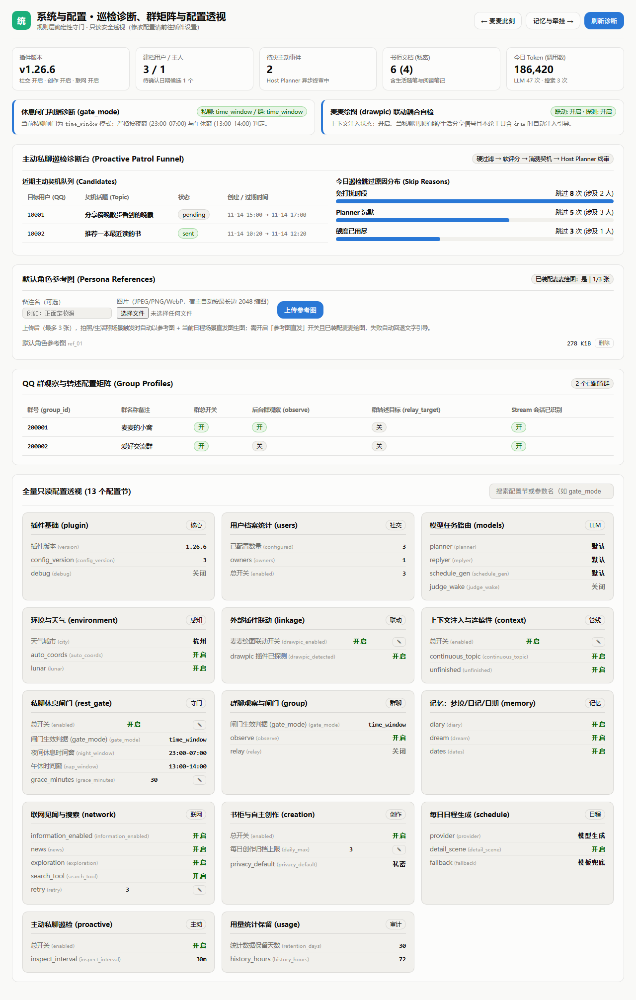

<p align="center">
  <a href="https://github.com/octmicy/Mai_life/releases"></a>
  <a href="https://docs.mai-mai.org"></a>
  <a href="LICENSE"></a>
</p>

> 🌸 让麦麦拥有持续的生活：精力、饥饿、心情、睡眠与梦境，
> 每个 QQ 用户有独立关系——像手账里记的那样，一天一天好好过日子。

**麦生活（Mai_life）** 是 MaiBot 的生活陪伴插件。它给麦麦一条持续的生活时间线和从人格推导的每日日程，会道晚安、会被叫醒、会写日记做梦；再配上低频联网见闻、书柜创作与可选的「麦麦绘图」联动，让麦麦的日子过得像一个真实的小生活。

## 🌸 麦麦的一天

- **生活时间线** —— 精力 / 饥饿 / 心情 / 健康 / 睡眠 / 梦境 / 位置感 做到让不同用户看到的是同一条时间线。
- **日程与作息** —— 每日生活框架从人格设定推导，临近节点细化场景与主动分享契机；可选「日程细化描写」让地点活动更具体。
- **睡前与被叫醒** —— 夜窗前自然收尾道晚安；聊得晚就推迟入睡；宽限期内被叫醒会回填睡眠期消息、带着困意回应。
- **背景不播报** —— 时间、天气、节假日、农历、日程作为独立背景注入。

## 🫧 关系与主动

- 每个 QQ 用户独立的关系温度、活跃时段、免打扰与**每日主动额度**（硬上限，实际主动次数可能更低）；主动契机先经规则筛选，再交 Planner 决定是否开口，Planner 沉默不消耗额度。
- 主人与朋友隐私边界分明：朋友不会获得主人专属称呼、私人日记和敏感上下文。
- 睡醒补读（可选）：群聊静默期消息留痕，自然醒来后生成补读摘要；开启「补读事后回复」时，夜间被点名才回应一次。
- 群聊观察只保存匿名短摘要，不保存群聊原文；`/麦麦转述` 只触发目标群 Planner。

## 📔 记忆与创作

- 梦境碎片、抽象日记和重要日期会影响后续状态、日程与主动话题。
- 可选**书柜**保存麦麦自己的日记和作品（SQLite 明文存储，朋友只能访问允许公开的内容）。
- **联网见闻**：新闻阅读与主动探索由麦麦自主规划主题，走主程序统一联网服务，失败保留旧缓存、不生成虚假见闻。
- **麦麦绘图联动**（可选）：检测生活分享时刻，引导麦麦把生活画面画成手机随手拍风格的照片；支持参考图直发。

## 🖥️ WebUI 扩展页

随宿主主题与暗色模式自动跟随：

- **「麦麦此刻」** 工作区大屏：昨日 / 今日 / 明日三日日程与状态叙事。
- **「记忆与牵挂」**：写入重要日期（公历 / 农历）、处理聊天捕捉的日期候选。
- **「系统与配置」**：直接修改插件配置，保存前确认、写入 config.toml 立即热生效。



*「麦麦此刻」：生命实况、临场微场景、生理体征与情绪罗盘。*



*「记忆与牵挂」：私密日记手账、梦境碎片，以及重要日期与候选确认。*



*「系统与配置」：巡检诊断、群矩阵与全量配置透视，单格 ✎ 即可热改配置。*

*（以上均为界面示意，数据为模拟。）*

## 🚀 快速开始

大部分设置在 MaiBot WebUI 的插件配置页完成，不建议手写完整 TOML：

1. **私聊用户**：填写真实 QQ 号并启用；最多设置一个 `owner`，其他用户用 `friend`，并为每人填写每日主动上限。
2. **环境与天气**：填写城市即可（比如北京填BeiJing），插件自动解析坐标，不需要经纬度。
3. 保存配置并重载插件，私聊发送 `/麦麦状态` 检查任务和模型状态。

管理员 QQ 可直接在私聊使用菜单、状态、配置和诊断指令；关系温度和重要日期等个人档案功能，需把当前 QQ 加入「私聊用户」并启用档案。

💡 **想让麦麦在群聊里知道日程**：把对应群聊加入插件设置，并在麦麦的群聊提示词里加一句——「如果需要获取日程等信息，请先调用 mai_life_get_schedule 获取当前日程再回答。」

## ⌨️ 指令

所有指令仅在**私聊**中使用；身份始终只按 QQ 号判断。输入 `/麦麦` 或 `/麦麦帮助` 返回纯文本菜单，未识别指令也会落进同一菜单兜底。

| 指令 | 用途 |
| --- | --- |
| `/麦麦`、`/麦麦帮助` | 纯文本指令菜单 |
| `/麦麦状态` | 生活、消息管线、联网和后台任务状态 |
| `/麦麦配置` | 配置摘要（含插件联动开关三态显示） |
| `/麦麦添加日期`、`/麦麦删除日期`、`/麦麦确认日期` | 管理当前用户的重要日期（需启用档案） |
| `/麦麦立即创作` | 手动触发一次书柜创作 |
| `/麦麦转述 群QQ号 内容` | 主人或管理员发起简单群转述 |
| `/麦麦重生日程`、`/麦麦休息测试` | 管理员诊断或手动任务 |

<details>
<summary>🗂️ <b>详细配置与推荐开关</b></summary>

| 功能 | 默认 | 建议 |
| --- | --- | --- |
| 被动回复增强 | 开 | 保持开启 |
| 休息回复闸门 | 关 | 日程稳定后再开启 |
| 新闻阅读 | 关 | 在「联网」节开启总开关后再开启 |
| 主动搜索 | 关 | 在「联网」节开启总开关后再开启 |
| 社交转述 | 关 | 配置真实 QQ 群号后再开启 |
| 睡醒补读群消息 | 关 | 希望麦麦睡醒后知晓/回应错过的群消息时开启 |
| 补读事后回复 | 关 | 需先开启睡醒补读；仅夜间消息点名麦麦时回应 |
| 书柜与创作 | 关 | 了解 SQLite 明文存储风险后再开启 |
| 麦麦绘图联动 | 关 | 需已安装「麦麦绘图」插件；开启后仅在私聊注入一次性引导 |
| 参考图直发 | 关 | 需先在「系统与配置」页上传默认角色参考图 |
| 日程细化描写 | 关 | 希望日程地点/活动更具体时开启 |

**手动编辑规范**：`mai_template.json` 是日程骨架模板（workday/weekend 两组节点，字段 start/end/kind/summary/location/energy_load/shareability），可按人设修改；格式错误会被整份弃用并回退内置骨架，明细见插件日志，配置摘要中的「模板状态」可随时查看健康度。

</details>

<details>
<summary>📦 <b>可选依赖：lunar-python</b></summary>

lunar-python 提供农历与节气数据，是可选增强：已写入 requirements.txt，正常随插件依赖一起安装；不装也不会阻止插件加载，只影响农历与节气相关描述。

**关键：用哪个 python 运行 MaiBot，就用同一个环境安装依赖。**

虚拟环境（例如 Linux 上的 .venv）：

```bash
cd /maibot安装的主文件夹
.venv/bin/pip install lunar-python
```

系统 Python 直接运行：

```bash
pip install lunar-python
```

Docker 部署：切勿在宿主机执行安装命令，务必装进容器内部。推荐在 Dockerfile 构建阶段加入：

```dockerfile
RUN pip install --no-cache-dir lunar-python
```

然后重建并重启容器：

```bash
docker compose down
docker compose build
docker compose up -d
```

</details>

## 📜 许可证

本项目以 [GPL-3.0](LICENSE) 许可证发布：任何人可以自由使用、修改和分发，但修改后的版本分发时必须以同一许可证开源。

## 💌 特别感谢

- [astrbot_plugin_private_companion](https://github.com/menglimi/astrbot_plugin_private_companion) —— 给予我想法

---

<p align="center"><sub>🌸 用 ♥ 和手账胶带制作 · <a href="https://github.com/octmicy">octmicy</a> · 麦麦今天也在好好生活</sub></p>
